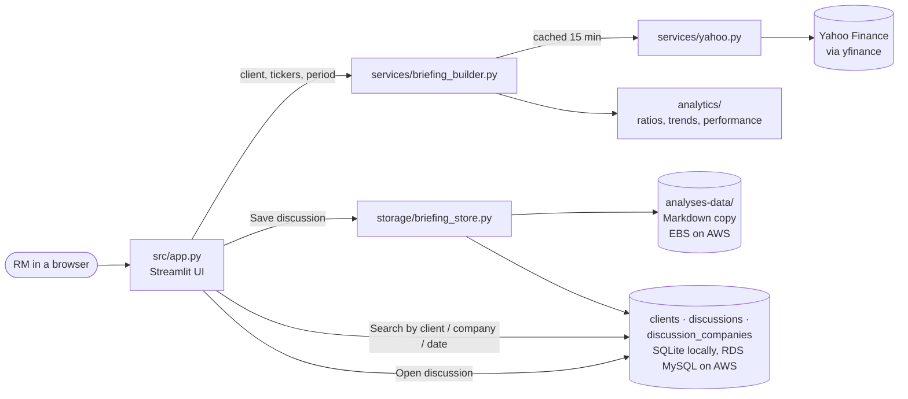
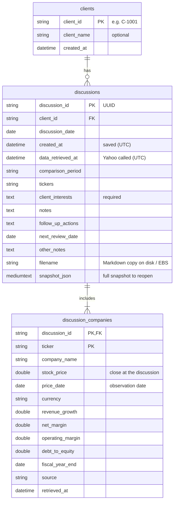
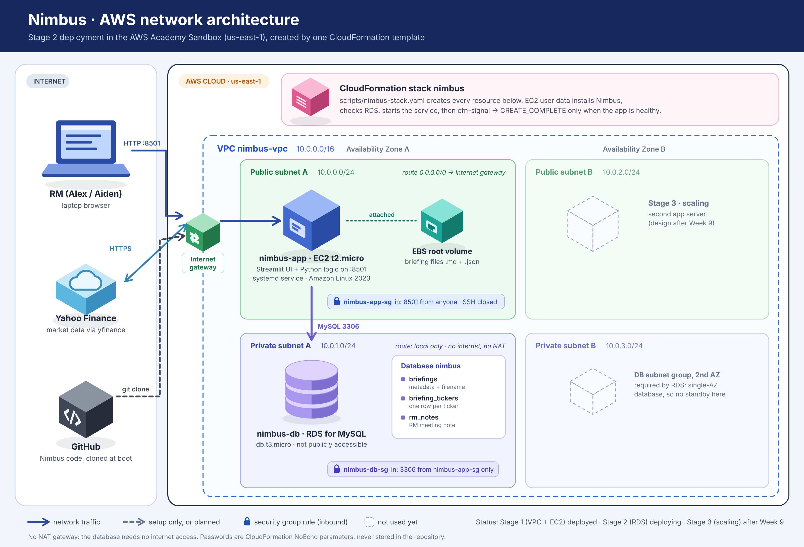

# ☁️ Nimbus: client discussions for relationship managers

Nimbus turns three separate Python notebooks (company financials, company news,
stock prices and analyst ratings) into one browser-based application for a
bank's relationship managers (RMs). Before or after meeting a client, an RM
picks the client, compares two or more companies (share prices side by side,
revenue growth, profit margins, debt-to-equity and their trends), reads
sourced news, records what the client is interested in, and saves the whole
discussion. Later they find it again by client or by company and reopen it
exactly as it was.

Built for SMU DS600 *Cloud Computing for Economics* (end-term group project).

> **Status (v0.10.2).** Implements the instructor's feedback of 27 Oct 2026:
> client-discussion snapshots (Client ID, ticker, discussion date, stock price
> at the time, client's interests) stored in `clients`, `discussions` and
> `discussion_companies`, retrievable by client and by company. The
> instructor's acceptance test steps 1–11 pass as an automated test
> (`tests/test_app_workflow.py`). **Step 12 (the same on Amazon RDS) passed in
> the AWS Sandbox on 29 Oct 2026 with v0.10.0, commit `02c72aa`**
> ([evidence](docs/evidence/2026-10-29-step12/README.md)). v0.10.1 (fixes from
> that run) and v0.10.2 (news summaries from Yahoo's RSS feed) are tested
> locally and not yet deployed. The environment is created by CloudFormation
> (VPC, EC2, RDS). Auto scaling (Feature 6) follows the Week 9 lesson; see
> [Project status](#project-status).

---

## Contents

1. [Quick start (Codespaces)](#quick-start-codespaces)
2. [Using Nimbus: the demo flow](#using-nimbus-the-demo-flow)
3. [Project status](#project-status)
4. [How it works](#how-it-works)
5. [Project structure](#project-structure)
6. [Data sources and calculation methods](#data-sources-and-calculation-methods)
7. [Storage and database design](#storage-and-database-design)
8. [Configuration](#configuration)
9. [Testing](#testing)
10. [Deploying to AWS](#deploying-to-aws)
11. [QA findings (25 Oct 2026)](#qa-findings-25-oct-2026)
12. [Known limitations](#known-limitations)
13. [Team and contributions](#team-and-contributions)

---

## Quick start (Codespaces)

From the repository folder in a terminal:

```bash
python3 -m venv .venv
source .venv/bin/activate
pip install -r requirements.txt
python3 -m streamlit run src/app.py
```

Codespaces then offers to open port 8501. Make the port **Public** if asked,
then choose **Open in Browser**.

`src/app.py` is the only application entry point. The app needs internet
access because it retrieves live data from Yahoo Finance.

The notebooks in `notebooks/` are the original prototypes. To run them, also
install Jupyter support: `pip install jupyter ipykernel`.

---

## Using Nimbus: the demo flow

This is the instructor's acceptance test, step by step.

1. **Client (step 1).** At the top of **New client discussion**, choose an
   existing client, or keep **➕ New client** and type a **Client ID** (e.g.
   `C-1001`; stored in capitals) and, optionally, the client's name.
2. **Companies (step 2).** In **Find companies**, type names or tickers and
   press Enter (`nvidia`, `Google`, `MU`, or a list such as
   `Apple, Microsoft, DBS`).
   - Well-known names are added at once. For other names Nimbus searches Yahoo
     Finance and lists the matches with an **Add** button; a misspelling gives
     one short message with a suggestion.
   - Chosen companies appear as chips (click × to remove) and in a check list
     with name, ticker and exchange. **Quick add** in the sidebar adds popular
     tickers. 2 to 6 companies.
3. **Generate comparison (step 3).** Choose a share-price period and select
   **Generate comparison**. Any company Yahoo cannot supply is listed in one
   collapsible notice; the others continue.
4. **📊 Compare (steps 4–5).**
   - **Share-price performance, side by side:** one chart, every company
     rebased to 100 (hover for the actual price), plus each company's last
     close and period return on its card.
   - **Financial comparison:** revenue growth, net profit margin, operating
     margin, **debt-to-equity**, net income growth, return on assets,
     debt-to-assets, P/E and market cap, with each company's fiscal year-end.
   - **Trends over time:** revenue growth, net margin and debt-to-equity for
     every fiscal year Yahoo reports, as charts and as a table.
   - Analyst view and earnings dates (context only).
5. **📑 Financials / 📰 News:** formatted annual statements; one news feed with
   linked headlines, publisher, date and summary. **Save to note** keeps an
   article with the discussion.
6. **📝 Discussion (steps 6–7).** The discussion date (today by default) and
   **the client's interests** are required; discussion notes, follow-up
   actions and a review date are optional. Select **💾 Save discussion**, here or
   in the header from any tab. Each discussion is saved once.
7. **🗂️ History (steps 8–10).** Filter by **client**, by **company** (ticker
   or name) and by discussion date; choose a result and select **Open
   discussion**. The five most recent discussions are also in the sidebar. A
   reopened discussion is labelled as a historical snapshot, shows the note,
   the **values at the time of the discussion** read from the database, and the
   comparison exactly as saved. It is never refreshed.

---

## Project status

Features are those agreed in the Lesson 4 Feature Request Workshop, as
clarified by the instructor's feedback on our proposal (27 Oct 2026). Marking
criteria are from the Lesson 5 slides.

| # | Feature | What Nimbus does | Status |
|---|---|---|---|
| 1 | Unified UI | One app combining financials, news and price/ratings; numbers formatted ($416.16B, 12.3%); news shows publisher (or the feed it came from), date, source link and a summary taken from Yahoo (search article or Yahoo's RSS headline feed), never generated; companies found by name or ticker | ✅ Working locally (v0.10.2). Live check on a laptop 29 Oct 2026: Yahoo's RSS feed gave summaries for 8 of the 13 relevant search articles, plus 22 relevant RSS-only articles. ⏳ Not yet on AWS |
| 2 | Company comparison | 2–6 companies: share prices side by side; revenue growth, net and operating margin, debt-to-equity, and their trends over the reported fiscal years; plus ROA, debt-to-assets, P/E, market cap | ✅ Working |
| 3 | Storage: save analysis | The complete discussion snapshot is saved: in the database (to reopen it) and as a Markdown file in `analyses-data/` (EBS on AWS) | ✅ Working |
| 4 | Storage: RM notes | Discussion snapshot with **Client ID, tickers, discussion date, stock price at the time, client's interests**, plus notes and follow-up actions | ✅ Working |
| 5 | Database search | `clients`, `discussions`, `discussion_companies` in SQL; search by client, company (ticker or name) and date; reopen the matching discussion | ✅ Working on Amazon RDS in the Sandbox: instructor's acceptance test step 12 passed on 29 Oct 2026 ([evidence](docs/evidence/2026-10-29-step12/README.md)); SQLite locally |
| 6 | Scaling | Automatically add and remove capacity | ⏳ After the Week 9 lesson. Reopening already works from any app server (snapshot stored in the database) |

| Marking area | Where to look |
|---|---|
| Repo completeness | This README, `requirements.txt`, `.gitignore`, `.env.example`, `tests/`, `scripts/`, `docs/` |
| Features & functionality | Table above; the instructor's acceptance test in `tests/test_app_workflow.py` |
| Cloud hosting | [Deploying to AWS](#deploying-to-aws), [`docs/aws-deployment.md`](docs/aws-deployment.md), [`docs/evidence/`](docs/evidence/) |

---

## How it works



**Generate.** `briefing_builder` fetches prices and company data per ticker.
Results are cached for 15 minutes, so changing other widgets never calls
Yahoo again. If one ticker fails it is reported, and the others continue.

**Compare.** `analytics/` computes the normalized measures and their yearly
trends. Missing inputs give N/A, never zero.

**Save.** The Markdown file is written first, then one database transaction
inserts the client (if new), the discussion (with the full snapshot as JSON)
and one row per company with the values observed at that moment. If the
database write fails, the file is removed, so the two never disagree. Saving
the same discussion twice is refused.

**Search and reopen.** SQL queries find discussions by client, company or
date. Reopening reads the snapshot from the database (so it works on any app
server) and never contacts Yahoo.

---

## Project structure

```text
.
├── src/
│   ├── app.py                    # Streamlit UI: the only entry point
│   ├── config.py                 # settings read from environment variables
│   ├── models/briefing.py        # Briefing (one comparison), CompanySnapshot, NewsItem, RmNote (the discussion note)
│   ├── services/
│   │   ├── yahoo.py              # all yfinance calls and parsing (from the notebooks)
│   │   ├── company_lookup.py     # resolve_company(): names/tickers -> ranked matches
│   │   └── briefing_builder.py   # combines several companies into one briefing
│   ├── ui/
│   │   ├── theme.py              # design system: palette, CSS, chips, section titles
│   │   ├── charts.py             # Altair: rebased share prices, ratio trends, analyst ratings bar
│   │   └── tables.py             # comparison and trend tables, analyst/earnings tables, ⚠ flags
│   ├── analytics/
│   │   ├── ratios.py             # growth, margins, debt-to-equity and their yearly trends
│   │   ├── performance.py        # rebased prices, holding-period return
│   │   └── formatting.py         # $M/$B, percentages, N/A
│   └── storage/
│       ├── snapshots.py          # Markdown copy in analyses-data/; snapshot JSON (de)serialisation
│       ├── database.py           # clients / discussions / discussion_companies: insert, search (SQLite or RDS)
│       └── briefing_store.py     # save a discussion once / reopen it, keeping file and DB in step
├── tests/                        # pytest: calculations, parsing, storage, full UI workflow
├── notebooks/                    # original notebooks (unchanged)
├── scripts/                      # nimbus-stack.yaml (deployment), check_database.py, debug_news.py, make_architecture_diagram.py, lesson templates
├── docs/aws-deployment.md        # step-by-step AWS deployment and evidence checklist
├── docs/evidence/                # dated deployment evidence (screenshots + results)
├── lessons/                      # course lesson notes
├── requirements.txt              # app dependencies
├── requirements-lock.txt         # exact versions installed on EC2 (Python 3.9)
├── requirements-dev.txt          # + pytest
├── .streamlit/config.toml        # dark theme, one accent colour (#2563EB)
├── .env.example                  # configuration variable names (no secrets)
└── .gitignore                    # excludes .venv/, analyses-data/, *.db, .env
```

`src/analysis.py` and `src/analysis_storage.py` from the Lesson 5–7 version
were replaced by `services/yahoo.py` and `storage/snapshots.py`. They remain
in the Git history on `main`.

---

## Data sources and calculation methods

**Source.** All data comes from Yahoo Finance through the `yfinance` package:
daily adjusted prices, annual income statement, balance sheet and cash flow,
market cap, trailing P/E, analyst recommendation counts and news. Every saved
company records its source, a link to its Yahoo quote page and the time it
was retrieved. Every news item keeps its own publisher, publication date and
source link. Nimbus never writes its own news summaries or links: if Yahoo
gives none, the app says so.

**News sources, in order** (`services/yahoo.py`, `fetch_news`):
1. Yahoo's news feed (`Ticker.get_news()`): headline, publisher, date, link and summary. In
   October 2026 it returned nothing for every ticker we tried, so in practice:
2. Yahoo search (`yf.Search`): headline, publisher, date and link, **no summary**. An article is
   kept only if Yahoo links it to the ticker **and** its headline or summary names the company.
3. Yahoo's RSS headline feed (`feeds.finance.yahoo.com/rss/2.0/headline?s=<ticker>`): headline,
   link, date and a short description, **no publisher**. Its description becomes the summary of
   the same search article (matched by headline or link), shown as "(summary via Yahoo Finance
   RSS)". RSS articles not found by search are added only if their **headline** names the
   company, and are shown as "via Yahoo Finance RSS (publisher not listed)". Singapore listings
   (e.g. DBS, `D05.SI`) get news only this way: Yahoo search returns none for them.

The newest 5 per company are kept, and they are saved with the discussion. If the RSS feed fails,
Nimbus shows the search articles as before and says the feed failed.
`python scripts/debug_news.py <tickers>` shows each source's raw response and the coverage.

**Measures** (FY = latest fiscal year, FY−1 = the previous one):

| Measure | Formula |
|---|---|
| Revenue growth | Revenue(FY) ÷ Revenue(FY−1) − 1 |
| Net income growth | Net income(FY) ÷ Net income(FY−1) − 1; N/A if FY−1 is zero or negative |
| Net profit margin | Net income(FY) ÷ Revenue(FY) |
| Operating margin | Operating income(FY) ÷ Revenue(FY) |
| Debt-to-equity | Total debt ÷ Shareholders' equity at FY year-end, shown as a multiple (0.45x); **N/M** (not meaningful) when equity is zero or negative |
| Trends over time | The same revenue growth, net margin and debt-to-equity for every fiscal year Yahoo reports (usually four; growth needs the year before) |
| Return on assets | Net income(FY) ÷ Total assets at FY year-end |
| Debt-to-assets | Total debt ÷ Total assets at FY year-end |
| P/E (trailing), market cap | As reported by Yahoo at retrieval time; a negative P/E shows N/A |
| Rebased share price | Adjusted close ÷ adjusted close on the first common date × 100 |
| Holding-period return | Last ÷ first adjusted close − 1, over dates every company traded |
| Upside to target | Analysts' mean price target ÷ last close − 1 |
| Earnings surprise | (Reported EPS − estimate) ÷ \|estimate\|; beat if reported > estimate |

**Rules.**
- A measure is N/A when an input is missing or a denominator is zero or negative.
- Balance-sheet values are only combined with income-statement values from the same fiscal year-end.
- Companies may have different fiscal year-ends; the comparison table shows which year each uses.
- Adjusted prices include dividends and splits.
- All measures are historical, not forecasts.

---

## Storage and database design

This follows the instructor's feedback (27 Oct 2026), building on the course
design (Lesson 7: save the analysis as a file on disk, which is EBS on AWS;
Lesson 8: store data about it in a database and search with SQL).

**Tables** (created automatically on first run):



- **One client has many discussions; one discussion includes many companies.**
- **Each company row keeps the values observed at the time** (stock price, its
  date, revenue growth, margins, debt-to-equity, source, retrieval time), so a
  reopened discussion never shows today's numbers as history.
- **`snapshot_json`** stores the complete comparison (charts, statements,
  news). Reopening reads it from the database, so it works on any app server.
  That is needed once several servers run behind a load balancer (Feature 6).
- **Files** (`analyses-data/`, excluded from Git): a readable Markdown copy of
  each discussion, e.g. `C-1001__AAPL-MSFT__20261027T130501Z__1a2b3c4d.md`,
  downloadable from the app. If a server does not have the file, the app
  rebuilds the same text from the stored snapshot.
- Numbers are stored as `DOUBLE`: MySQL's `FLOAT` keeps only about 7 digits,
  so a saved value would not read back exactly.

Example searches:

```sql
-- every discussion with client C-1001, newest first
SELECT d.discussion_date, d.tickers, d.client_interests
FROM discussions d
WHERE d.client_id = 'C-1001'
ORDER BY d.discussion_date DESC;

-- every discussion that included NVIDIA, with the price at the time
SELECT d.discussion_date, d.client_id, c.stock_price, c.price_date
FROM discussions d JOIN discussion_companies c ON c.discussion_id = d.discussion_id
WHERE c.ticker = 'NVDA' OR LOWER(c.company_name) LIKE '%nvidia%'
ORDER BY d.discussion_date DESC;
```

The code uses SQLAlchemy, so the same queries run on SQLite locally and on
Amazon RDS for MySQL on AWS; only `NIMBUS_DATABASE_URL` changes.

---

## Configuration

Nimbus reads environment variables; see `.env.example` for the names. With
nothing set, it uses `analyses-data/` and a SQLite file inside it.

| Variable | Default | Purpose |
|---|---|---|
| `NIMBUS_DATA_DIR` | `<repo>/analyses-data` | Where the Markdown copies are written |
| `NIMBUS_DATABASE_URL` | `sqlite:///<repo>/analyses-data/nimbus.db` | Discussion database; for RDS: `mysql+pymysql://<user>:<password>@<endpoint>:3306/<db>` |
| `NIMBUS_TIMEZONE` | `Asia/Singapore` | Time zone for displayed times and for the default discussion date. Times are stored in UTC. |

Never commit real credentials. `.env` files are ignored by Git.

---

## Testing

**Automated tests.** These need no internet; Yahoo is replaced by
`tests/fake_yahoo.py`:

```bash
pip install -r requirements-dev.txt
python -m pytest
```

They cover:
- formatting, ratio, trend and return calculations, including N/A and N/M cases;
- news and statement parsing;
- saving a discussion exactly once, with every company's values at the time;
- rollback when the database fails; invalid client IDs and missing interests rejected;
- search by client, company (ticker or name) and date;
- reopening from the database without calling Yahoo, even without the file;
- `tests/test_app_workflow.py::test_instructor_acceptance_test`, which drives
  the real Streamlit app through the instructor's acceptance test, steps 1–11:
  client → two tickers → generate → prices side by side → revenue growth,
  margin and debt-to-equity → client's interests → save → search by client and
  reopen → search by ticker and reopen → reopened values equal the saved ones →
  restart and retrieve again. Step 12 is the same on Amazon RDS (see below);
- `tests/test_qa_regressions.py`, one test per defect found in the QA run on
  the AWS deployment (see [QA findings](#qa-findings-25-oct-2026)). Each was
  checked to fail on the code before the fix.

**Against MySQL.** The same suite can run against a MySQL database instead of
SQLite (use an empty, throwaway database; its Nimbus tables are dropped before
each test):

```bash
NIMBUS_TEST_DATABASE_URL='mysql+pymysql://<user>:<password>@127.0.0.1:3306/nimbus_test' python -m pytest
```

All 130 tests pass on MariaDB 10.11 (MySQL-compatible) through PyMySQL.
`python scripts/check_database.py` checks that the configured database is
reachable and its tables exist, printing only the host and row counts, never
the password.

Verified on Python 3.13 (Streamlit 1.66, pandas 3.1, Altair 6) and Python 3.9
(Streamlit 1.50, pandas 2.3, Altair 5). Python 3.9 is the version on Amazon
Linux 2023. Streamlit 1.44 or newer is required.

**News troubleshooting.** If the News tab says news could not be retrieved,
see exactly what Yahoo returns:

```bash
python scripts/debug_news.py AAPL MSFT
```

It prints the raw output of yfinance's news feed and of Yahoo search (which
Nimbus falls back to when the feed is empty), any yfinance warnings, and how
many articles Nimbus could read.

**Manual check with live data** (run in Codespaces before every demo):

1. Fresh venv, `pip install -r requirements.txt`, start the app.
2. In Find companies type `nvid` and press Enter: NVIDIA (NVDA) · NASDAQ is
   offered; add it. Then type `Apple, Microsoft` and press Enter. Check the
   list shows names, tickers and exchanges, then generate.
3. Check the price chart, the comparison table (including debt-to-equity),
   the trend charts and the formatted financials.
4. Check that news shows links, publishers and dates.
5. Choose **➕ New client**, enter Client ID `C-1001`, write the client's
   interests in **📝 Discussion** and save. "This discussion snapshot was saved" appears.
6. In **🗂️ History**, the caption shows 1 client, 1 discussion and 3 company records.
7. Filter by client `C-1001`, open the discussion: the snapshot banner, your
   note and the values at the time of the discussion are shown. Then search
   company `nvidia` and open it again.
8. Stop the app (Ctrl+C), start it again, then search and open again.
9. Generate `AAPL, ZZZZ, MSFT`. ZZZZ is reported and the others still load.

---

## Deploying to AWS



Nimbus is deployed with CloudFormation from [`scripts/nimbus-stack.yaml`](scripts/nimbus-stack.yaml).
Full steps, evidence checklist, troubleshooting and clean-up are in
[`docs/aws-deployment.md`](docs/aws-deployment.md).

In short:
1. Push to GitHub. EC2 clones from GitHub.
2. In the Sandbox, open **CloudFormation → Create stack → Upload a template file**, choose
   `scripts/nimbus-stack.yaml`, name the stack `nimbus`, type a new `DBPassword`
   (letters and digits, never a real password), and set `GitBranch` if not `main`.
3. Wait for `CREATE_COMPLETE` (about 15–20 minutes, mostly RDS). It is only reported after
   Nimbus has connected to RDS and answers its health check.
4. Open the `NimbusUrl` output (http://…:8501).

| Stage | What it adds | Status |
|---|---|---|
| 1 | VPC with public and private subnets, security group, EC2 installed by user data and run as a systemd service | ✅ Deployed in the Sandbox (`CREATE_COMPLETE`, app reachable) |
| 2 | Amazon RDS for MySQL in the private subnets, reachable only from the app server | ✅ Deployed and verified in the Sandbox (25 and 27 Oct 2026), including a reboot. [Evidence](docs/evidence/2026-10-27-stage2/README.md). The template does not change for v0.10.0: the app creates the new tables on first start |
| 2b | Instructor's acceptance test step 12: steps 1–11 on Amazon RDS with v0.10.0 | ✅ Passed on 29 Oct 2026, including a reboot. [Evidence](docs/evidence/2026-10-29-step12/README.md); the small defects found are fixed in v0.10.1 |
| 3 | Scaling (Week 9 lesson) | Not started |

`scripts/lesson5.yaml` and `scripts/lesson5-nimbus.yaml` are the course's
Lesson 6–7 templates, kept for reference.

## QA findings (25 Oct 2026)

Four test briefings (run `AWS-QA-20261024T181839Z`) were created, saved,
searched and reopened through the deployed app on AWS. Saving, reopening and
search all matched the expected results. The defects found, and what was done:

| Defect | Severity | Cause | Status |
|---|---|---|---|
| Typed note text lost; Notes tab jumps back to Compare | High | On Streamlit 1.50 (EC2), the tabs reset when the number of page elements above them changes between runs (the spinner after generating), dropping text not yet committed | ✅ Fixed: everything above the tabs sits in containers that exist on every run. Checked in a browser on 1.50 and 1.66 |
| Unrelated news (Netflix, Nike) shown for NVDA | Medium | When the news feed is empty, the Yahoo search fallback fell back again to all search results | ✅ Fixed: only articles Yahoo links to the ticker; otherwise "no linked articles" is stated |
| Still unrelated news in run 2 (PagSeguro under NVDA; Meta, Anthropic under MSFT) | Medium | Yahoo links general articles to many tickers | ✅ Fixed in 0.9.1: kept only if the headline or summary also names the company (name or alias, e.g. "Google" for GOOGL) or its ticker |
| Meeting date and saved news dates one day behind after midnight SGT | Low | The server's own date is UTC | ✅ Fixed in 0.9.1: local date |
| Old results shown under the date-range error | Low | Search still ran with the previous filters | ✅ Fixed in 0.9.1 |
| Date boxes too narrow | Low | Five fields in one row | ✅ Fixed in 0.9.1: two rows |
| Commit not visible in stack events | Medium | CloudFormation shows its own text for a success signal | ✅ Commit shown in the app sidebar and the EC2 system log; sidebar also shows when the server started |
| "Retrieved" time later than the real retrieval | Medium | Data is reused for 15 minutes, but the time shown was when the briefing was built | ✅ Fixed: each company records when Yahoo was called |
| Date search in UTC: 25 Oct (Singapore) found nothing | Medium | Search used the UTC date | ✅ Fixed: local date (`NIMBUS_TIMEZONE`, default Singapore); all times shown in SGT |
| "From" after "to" accepted silently | Low | No check | ✅ Fixed: error message |
| Selector showed a different briefing from the open one | Medium | Selector always defaulted to the newest result | ✅ Fixed: follows the open briefing |
| Missing statement item dropped (NVDA total liabilities) | Medium | Only reported items were listed | ✅ Fixed: every standard item listed, N/A if not reported |
| Earnings table shows "None"; legend said "Blank" | Low | Streamlit shows missing values as "None" | ✅ Legend corrected |
| Same article under two tickers | Low | The article is linked to both | Kept, and documented |
| No load balancer; single server | Medium | Scaling is Stage 3 | ⏳ After the Week 9 lesson |
| Database host shown in History | Low | Deliberate demo evidence | Kept (password never shown) |
| No segment data (e.g. cloud) | Low | Not provided by Yahoo | Documented in limitations |

The four QA briefings saved before the date fix keep their UTC search date.
QA run 2 (27 Oct 2026) passed every other check, including the reboot test:
[evidence](docs/evidence/2026-10-27-stage2/README.md).

**QA run 3 (29 Oct 2026): the instructor's acceptance test step 12 on Amazon
RDS** passed 29 of 30 checks, including steps 1–11 and a reboot. One medium
defect (the save pop-up stayed open after saving) and six low ones are fixed
in v0.10.1. The list is in the
[step 12 evidence](docs/evidence/2026-10-29-step12/README.md#defects-found-and-fixes-in-v0101).

## Known limitations

- **Yahoo Finance via yfinance** is an unofficial interface. Fields can be
  missing or change format; Nimbus shows N/A or "not provided" rather than
  guessing. Statement coverage is usually the last four fiscal years.
- **News** is the latest available at retrieval time; Yahoo does not provide
  historical news searches. Summaries are Yahoo's own short descriptions,
  not full-article summaries, and some articles have none (e.g. both NVDA
  articles in the 29 Oct check). Articles found only in the RSS feed have no
  publisher. The RSS feed is a public but undocumented Yahoo endpoint and could
  change; Nimbus then falls back to search results only. Relevance filtering
  can leave a company with no news rather than unrelated stories. An article
  linked to two companies in the briefing appears under both.
- **Company-wide figures only.** Yahoo provides no segment data (for example
  cloud revenue), so comparisons use whole-company statements.
- **The History tab shows the database host** (never the password). This is
  deliberate: it is the visible proof, for the demo, that search runs on RDS.
- **Ratios** use annual statements only (no quarterly or trailing-twelve-month
  figures).
- **Analyst targets and earnings dates** are third-party figures from Yahoo at
  the time of retrieval; earnings dates can move, and coverage is thinner for
  non-US listings (shown as N/A). Nimbus shows them for context and makes no
  recommendation of its own.
- **Saved articles** are stored in the discussion's snapshot (database JSON and
  Markdown copy), not as separate database rows.
- **Unusual values are flagged, not changed.** A trailing P/E above 100x or an
  EPS surprise above ±100% is shown as reported with a ⚠ marker, because such
  figures often reflect one-off items or depressed earnings.
- **Layout** is capped at 1300px wide. If the page still looks narrow, check
  **⋮ → Settings → Wide mode** in the app menu (a per-browser setting).
- **Markdown copies are local to one machine.** Each app server keeps the
  Markdown copies it wrote. Reopening does not depend on them (the snapshot is
  in the database, and the download is rebuilt from it when the file is
  missing), so this does not block scaling.
- **Debt-to-equity is not comparable across industries.** Banks (e.g. DBS,
  OCBC, UOB) carry far more debt by design than technology companies.
  Industry-specific comparison templates were judged an advanced feature and
  deferred.
- **Earlier saved briefings are not migrated.** v0.10.0 replaced the
  `briefings` / `briefing_tickers` / `rm_notes` tables with the client-discussion
  tables. Test briefings saved by earlier versions are not listed.
- **Client IDs are typed by the RM.** There is no link to a client master
  database, and no check beyond the format (1–32 letters, digits, - or _).
- **Database password handling.** The RDS password is a `NoEcho` CloudFormation
  parameter. On the instance it is kept in `/etc/nimbus.env` (readable by root
  only) and setup logging is switched off before it is written. It is still
  part of the instance's user data, which anyone with EC2 console access to the
  account can view. AWS Secrets Manager would avoid that; it is beyond the
  course requirements and was not used.
- **Sandbox database settings:** single-AZ, 20 GB, no automated backups, and
  deleted together with the stack. These keep the Sandbox cost and creation
  time low; production would use Multi-AZ and backups.
- **No user accounts:** everyone using an instance sees the same clients and
  history.
- **Company search** runs when you press Enter, not on every keystroke
  (true as-you-type search would need a third-party Streamlit component and a
  Yahoo call per key press). Results are cached for a day.
- **Name lookup** first checks a built-in list of about 90 well-known names
  (US large caps, major SGX stocks), then Yahoo Finance search. Search results
  are ranked by listing (US primary exchanges, then other primary exchanges,
  then over-the-counter) and Yahoo's relevance, not by market capitalisation.
  If Yahoo search is unreachable, ticker symbols still work.
- **Windows:** keep the project outside Google Drive, OneDrive or Dropbox
  folders. Cloud-synced folders lock files and cause "Permission denied"
  errors (and can corrupt `.git`).

---

## Team and contributions

| Member | Responsibilities | Main contributions |
|---|---|---|
| _Name_ | _e.g. data layer, calculations_ | _to be completed by the team_ |
| _Name_ | _e.g. UI, storage, database_ | _to be completed by the team_ |
| _Name_ | _e.g. CloudFormation, AWS deployment_ | _to be completed by the team_ |

Course: SMU DS600 Cloud Computing for Economics. Starter repository and lessons
by Gaurav Chaturvedi.
