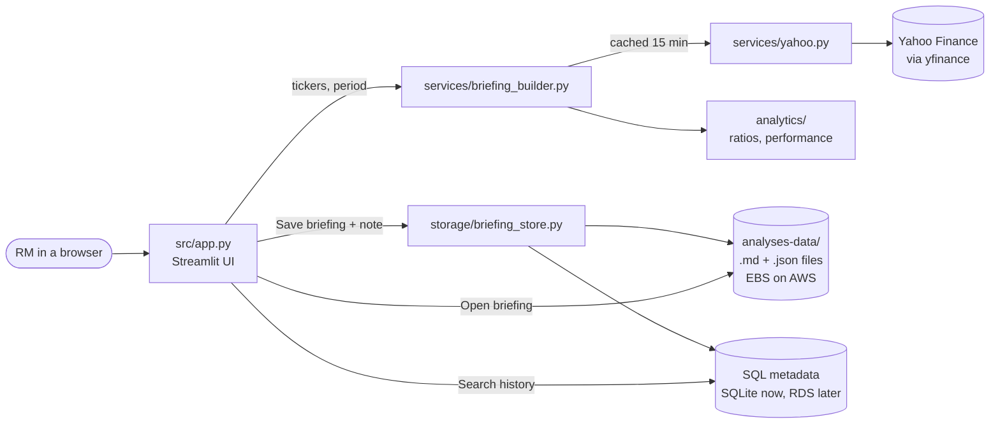

# ☁️ Nimbus: company briefings for relationship managers

Nimbus turns three separate Python notebooks (company financials, company news,
stock prices and analyst ratings) into one browser-based application. A
relationship manager (RM) can compare companies, review formatted financials,
read sourced news, record meeting notes, save the whole briefing, and later
search for it and reopen it exactly as it was.

Built for SMU DS600 *Cloud Computing for Economics* (end-term group project).

> **Status (prototype v0.3.0, local).** Features 1–5 work end to end in
> GitHub Codespaces using SQLite and local files. Moving the database to
> Amazon RDS and adding auto scaling (Feature 6) are the next stages; see
> [Project status](#project-status) and [Known limitations](#known-limitations).

---

## Contents

1. [Quick start (Codespaces)](#quick-start-codespaces)
2. [Using Nimbus: the demo flow](#using-nimbus-the-demo-flow)
3. [Project status](#project-status)
4. [How it works](#how-it-works)
5. [Project structure](#project-structure)
6. [Data sources and calculation methods](#data-sources-and-calculation-methods)
7. [Storage and database design](#storage-and-database-design)
8. [Configuration](#configuration)
9. [Testing](#testing)
10. [Deploying to AWS](#deploying-to-aws)
11. [Known limitations](#known-limitations)
12. [Team and contributions](#team-and-contributions)

---

## Quick start (Codespaces)

From the repository folder in a terminal:

```bash
python3 -m venv .venv
source .venv/bin/activate
pip install -r requirements.txt
python3 -m streamlit run src/app.py
```

Codespaces then offers to open port 8501. Make the port **Public** if asked,
then choose **Open in Browser**.

`src/app.py` is the only application entry point. The app needs internet
access because it retrieves live data from Yahoo Finance.

The notebooks in `notebooks/` are the original prototypes. To run them, also
install Jupyter support: `pip install jupyter ipykernel`.

---

## Using Nimbus: the demo flow

1. **New briefing:** type tickers or company names (e.g. `Apple, Microsoft`
   or `AAPL MSFT`), or use **Quick add** in the sidebar. Press Enter to see the
   companies as badges, choose a share-price period and select **Generate
   briefing**. Anything that could not be used is listed in one collapsible
   notice, with a suggestion where possible.
2. **📊 Compare:** a card per company (last close with period return, market
   cap, P/E), the financial comparison table, and an interactive share-price
   chart rebased to 100 (hover for date and actual price).
3. **📑 Financials:** annual statement line items, formatted in millions,
   billions or trillions.
4. **📰 News & ratings:** analyst recommendation counts and recent news, each
   with publisher, date, summary and a link to the source.
5. **📝 Notes & save:** fill in the meeting note, then select **Save
   briefing and RM notes**. Each briefing can be saved once.
6. **🗂️ History:** filter by ticker, date range, client reference or analysis
   type; choose a result and select **Open briefing**. The five most recent
   briefings are also one click away in the sidebar. A reopened briefing is
   labelled as a historical snapshot and is never refreshed.

---

## Project status

Features are those agreed in the Lesson 4 Feature Request Workshop. Marking
criteria are from the Lesson 5 slides.

| # | Feature | What Nimbus does | Status |
|---|---|---|---|
| 1 | Unified UI | One app combining financials, news and price/ratings; numbers formatted ($416.16B, 12.3%); news shows summary, publisher, date and source link; accepts company names as well as tickers | ✅ Working locally |
| 2 | Company comparison | Two or more companies; revenue and net-income growth, net margin, return on assets, debt-to-assets, P/E, market cap; rebased share-price chart and holding-period return | ✅ Working locally |
| 3 | Storage: save analysis | Complete briefing saved as a Markdown file (plus JSON snapshot) in `analyses-data/`; listed and reopened without re-downloading | ✅ Working locally; on EC2 the folder is on the instance's EBS volume |
| 4 | Storage: RM notes | Structured meeting note saved with, and linked to, its briefing | ✅ Working locally |
| 5 | Database search | Metadata in SQL tables; search by ticker, date range, client reference, analysis type; open the matching briefing | ✅ Working with SQLite. ⏳ Amazon RDS not yet deployed |
| 6 | Scaling | Automatically add and remove capacity | ⏳ Not started (taught in Week 9) |

| Marking area | Where to look |
|---|---|
| Repo completeness | This README, `requirements.txt`, `.gitignore`, `.env.example`, `tests/`, `scripts/` |
| Features & functionality | Table above; acceptance test in `tests/test_app_workflow.py` |
| Cloud hosting | [Deploying to AWS](#deploying-to-aws) |

---

## How it works



**Generate.** `briefing_builder` fetches prices and company data per ticker.
Results are cached for 15 minutes, so changing other widgets never calls
Yahoo again. If one ticker fails it is reported, and the others continue.

**Compare.** `analytics/` computes normalized measures. Missing inputs give
N/A, never zero.

**Save.** The briefing and note are written first to two files, then to the
database in one transaction. If the database write fails, the files are
removed, so file storage and database never disagree. Saving the same
briefing twice is refused.

**Search and reopen.** SQL queries on the metadata find the briefing. The app
then reads its JSON snapshot. Reopening never contacts Yahoo.

---

## Project structure

```text
.
├── src/
│   ├── app.py                    # Streamlit UI: the only entry point
│   ├── config.py                 # settings read from environment variables
│   ├── models/briefing.py        # Briefing, CompanySnapshot, NewsItem, RmNote
│   ├── services/
│   │   ├── yahoo.py              # all yfinance calls and parsing (from the notebooks)
│   │   ├── ticker_input.py       # company names / separators -> ticker symbols
│   │   └── briefing_builder.py   # combines several companies into one briefing
│   ├── analytics/
│   │   ├── ratios.py             # growth rates and financial ratios
│   │   ├── performance.py        # rebased prices, holding-period return
│   │   └── formatting.py         # $M/$B, percentages, N/A
│   └── storage/
│       ├── snapshots.py          # Markdown + JSON files in analyses-data/
│       ├── database.py           # SQL schema, insert, search (SQLite or RDS)
│       └── briefing_store.py     # save once / reopen, keeping files and DB in step
├── tests/                        # pytest: calculations, parsing, storage, full UI workflow
├── notebooks/                    # original notebooks (unchanged)
├── scripts/                      # CloudFormation templates from Lessons 6–7
├── lessons/                      # course lesson notes
├── requirements.txt              # app dependencies
├── requirements-dev.txt          # + pytest
├── .streamlit/config.toml        # theme: one accent colour (#2563EB)
├── .env.example                  # configuration variable names (no secrets)
└── .gitignore                    # excludes .venv/, analyses-data/, *.db, .env
```

`src/analysis.py` and `src/analysis_storage.py` from the Lesson 5–7 version
were replaced by `services/yahoo.py` and `storage/snapshots.py`. They remain
in the Git history on `main`.

---

## Data sources and calculation methods

**Source.** All data comes from Yahoo Finance through the `yfinance` package:
daily adjusted prices, annual income statement, balance sheet and cash flow,
market cap, trailing P/E, analyst recommendation counts and news. Every saved
company records its source, a link to its Yahoo quote page and the time it
was retrieved. Every news item keeps its own publisher, publication date and
source link. Nimbus never writes its own news summaries or links: if Yahoo
gives none, the app says so.

**Measures** (FY = latest fiscal year, FY−1 = the previous one):

| Measure | Formula |
|---|---|
| Revenue growth | Revenue(FY) ÷ Revenue(FY−1) − 1 |
| Net income growth | Net income(FY) ÷ Net income(FY−1) − 1; N/A if FY−1 is zero or negative |
| Net profit margin | Net income(FY) ÷ Revenue(FY) |
| Return on assets | Net income(FY) ÷ Total assets at FY year-end |
| Debt-to-assets | Total debt ÷ Total assets at FY year-end |
| P/E (trailing), market cap | As reported by Yahoo at retrieval time; a negative P/E shows N/A |
| Rebased share price | Adjusted close ÷ adjusted close on the first common date × 100 |
| Holding-period return | Last ÷ first adjusted close − 1, over dates every company traded |

**Rules.**
- A measure is N/A when an input is missing or a denominator is zero or negative.
- Balance-sheet values are only combined with income-statement values from the same fiscal year-end.
- Companies may have different fiscal year-ends; the comparison table shows which year each uses.
- Adjusted prices include dividends and splits.
- All measures are historical, not forecasts.

---

## Storage and database design

This follows the course design:
- **Lesson 7:** save the analysis as a Markdown file on disk, which is EBS on AWS.
- **Lesson 8:** save metadata about each file in a database and search it with SQL instead of guessing filenames.

**Files** (`analyses-data/`, excluded from Git):
- `AAPL-MSFT__company-briefing__20261024T130501Z__1a2b3c4d.md`: readable briefing, downloadable from the app.
- The matching `.json` file: the exact snapshot used to reopen the briefing.

**Tables:**

| Table | Columns | Purpose |
|---|---|---|
| `briefings` | `briefing_id` (PK, UUID), `created_at`, `saved_at`, `analysis_date`, `analysis_type`, `analysis_period`, `client_reference`, `tickers`, `filename`, `json_filename`, `schema_version`, `app_version` | One row per saved briefing |
| `briefing_tickers` | `id` (PK), `briefing_id` (FK), `ticker` | One row per company in a briefing |
| `rm_notes` | `note_id` (PK), `briefing_id` (FK, unique), `meeting_date`, `next_review_date`, `discussion_summary`, `client_priorities`, `follow_up_actions`, `free_text`, `created_at` | The RM's meeting note |

Joining `briefings` and `briefing_tickers` gives the Lesson 8 example table
(`ticker`, `analysis_type`, `date`, `filename`). For example, every briefing
that includes Micron:

```sql
SELECT b.saved_at, b.tickers, b.client_reference, b.filename
FROM briefings b
WHERE b.briefing_id IN (SELECT briefing_id FROM briefing_tickers WHERE ticker = 'MU')
ORDER BY b.saved_at DESC;
```

Tables are created automatically on first run. The code uses SQLAlchemy, so
the same queries run on SQLite now and on RDS for MySQL later.

---

## Configuration

Nimbus reads environment variables; see `.env.example` for the names. With
nothing set, it uses `analyses-data/` and a SQLite file inside it.

| Variable | Default | Purpose |
|---|---|---|
| `NIMBUS_DATA_DIR` | `<repo>/analyses-data` | Where briefing files are written |
| `NIMBUS_DATABASE_URL` | `sqlite:///<repo>/analyses-data/nimbus.db` | Metadata database; for RDS: `mysql+pymysql://<user>:<password>@<endpoint>:3306/<db>` |

Never commit real credentials. `.env` files are ignored by Git.

---

## Testing

**Automated tests.** These need no internet; Yahoo is replaced by
`tests/fake_yahoo.py`:

```bash
pip install -r requirements-dev.txt
python -m pytest
```

They cover:
- formatting, ratio and return calculations, including N/A cases;
- news and statement parsing;
- saving exactly once;
- rollback when the database fails;
- search filters;
- reopening without calling Yahoo;
- `tests/test_app_workflow.py`, which drives the real Streamlit app through
  the full acceptance workflow: generate → compare → note → save → search →
  reopen → restart → reopen → invalid ticker.

Verified on Python 3.13 (Streamlit 1.66, pandas 3.1, Altair 6) and Python 3.9
(Streamlit 1.50, pandas 2.3, Altair 5). Python 3.9 is the version on Amazon
Linux 2023. Streamlit 1.44 or newer is required.

**Manual check with live data** (run in Codespaces before every demo):

1. Fresh venv, `pip install -r requirements.txt`, start the app.
2. Enter `Apple, Microsoft`, press Enter (badges show AAPL and MSFT), generate.
3. Check the chart, comparison table and formatted financials.
4. Check that news shows links, publishers and dates.
5. Enter a note and save. The save button disappears and the filename is shown.
6. In Briefing history, the caption shows 1 briefing, 2 ticker records and 1 RM note.
7. Search `MSFT`, then open the briefing. It shows the snapshot banner and your note.
8. Stop the app (Ctrl+C), start it again, then search and open again.
9. Generate `AAPL, ZZZZ, MSFT`. ZZZZ is reported and the others still load.

---

## Deploying to AWS

`scripts/lesson5-nimbus.yaml` is the Lesson 7 CloudFormation template. It
creates a VPC, public subnet, internet gateway, security group and an EC2
instance whose user data clones this repository, installs
`requirements.txt` and runs `src/app.py` on port 8501.

1. Push your changes to GitHub. EC2 clones from GitHub, not from Codespaces.
2. In the AWS Sandbox open **CloudFormation → Create stack → Upload a
   template file**, and choose `scripts/lesson5-nimbus.yaml`.
3. Set **GitHubRepoUrl** to this repository's `.git` URL.
4. When the stack shows `CREATE_COMPLETE`, wait a few minutes for the install.
   Then open the **StreamlitUrl** output, using `http://`, not `https://`.
5. If the page does not load: **EC2 → instance → Actions → Monitor and
   troubleshoot → Get system log**.

**What this deploys today:** the full prototype on one EC2 instance, with
briefing files and SQLite on the instance's EBS root volume. This meets the
"hosted on AWS" stage, but **not** yet the Lesson 8 RDS design or Feature 6.

**Next stages:**
- Add RDS (private subnets, reachable only from the EC2 security group) to the template, and pass `NIMBUS_DATABASE_URL` to the app.
- Add scaling resources per the Week 9 lesson.

---

## Known limitations

- **Yahoo Finance via yfinance** is an unofficial interface. Fields can be
  missing or change format; Nimbus shows N/A or "not provided" rather than
  guessing. Statement coverage is usually the last four fiscal years.
- **News** is the latest available at retrieval time; Yahoo does not provide
  historical news searches.
- **Ratios** use annual statements only (no quarterly or trailing-twelve-month
  figures).
- **Files are local to one machine.** Briefings saved in Codespaces and on EC2
  are separate. With auto scaling (several EC2 instances), a briefing saved on
  one instance's disk would not be readable from another. The storage design
  must be revisited for Feature 6.
- **No user accounts:** everyone using an instance sees the same history.
- **Analysis type** is always `company_briefing` in this version; the filter
  exists so other analysis types can be added later.
- **Company-name lookup** uses a built-in list of about 90 well-known names
  (US large caps and major SGX stocks). Other companies must be entered by
  ticker; misspellings get a suggestion where one is close.
- **Windows:** keep the project outside Google Drive, OneDrive or Dropbox
  folders. Cloud-synced folders lock files and cause "Permission denied"
  errors (and can corrupt `.git`).

---

## Team and contributions

| Member | Responsibilities | Main contributions |
|---|---|---|
| _Name_ | _e.g. data layer, calculations_ | _to be completed by the team_ |
| _Name_ | _e.g. UI, storage, database_ | _to be completed by the team_ |
| _Name_ | _e.g. CloudFormation, AWS deployment_ | _to be completed by the team_ |

Course: SMU DS600 Cloud Computing for Economics. Starter repository and lessons
by Gaurav Chaturvedi.
