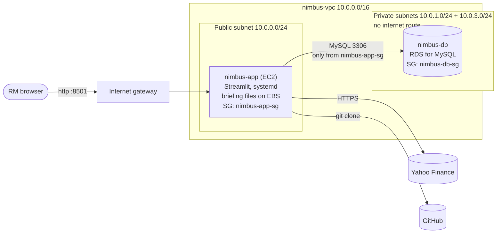

# Deploying Nimbus to the AWS Academy Sandbox

Template: [`scripts/nimbus-stack.yaml`](../scripts/nimbus-stack.yaml) (CloudFormation).
Region: **us-east-1** (the only region the Sandbox allows).

The deployment is built in stages. Each stage is the same template, extended:

| Stage | Adds | Status |
|---|---|---|
| 1 | VPC (2 public + 2 private subnets), security group, EC2 app server installed by user data, systemd service, health-checked `CREATE_COMPLETE` | ✅ Deployed in the Sandbox |
| 2 | Amazon RDS for MySQL in the private subnets; database security group that accepts MySQL only from the app server; app connected to RDS | ✅ Deployed and verified (25 and 27 Oct 2026), including the reboot test. Evidence: [`docs/evidence/2026-10-27-stage2`](evidence/2026-10-27-stage2/README.md) |
| 3 | Scaling, per the Week 9 lesson | After Week 9 |

## Architecture (Stage 2)


The same in text form (renders on GitHub):



## What the stack creates

| Resource | Name tag | Purpose |
|---|---|---|
| VPC 10.0.0.0/16 | `nimbus-vpc` | Private network for Nimbus |
| Internet gateway | `nimbus-igw` | Lets the public subnets reach the internet |
| Public subnets 10.0.0.0/24, 10.0.2.0/24 | `nimbus-public-a`, `nimbus-public-b` | App server (first AZ); second AZ ready for scaling |
| Private subnets 10.0.1.0/24, 10.0.3.0/24 | `nimbus-private-a`, `nimbus-private-b` | The database; **no route to the internet** |
| Route tables | `nimbus-rtb-public`, `nimbus-rtb-private` | Public: 0.0.0.0/0 → internet gateway. Private: local only (no NAT gateway, so no NAT cost) |
| App security group | `nimbus-app-sg` | Port 8501 from `AllowedWebCidr` (default anyone); SSH closed unless `AllowedSshCidr` is set |
| Database security group | `nimbus-db-sg` | Port 3306 **only from `nimbus-app-sg`**; nothing else can connect |
| DB subnet group | `nimbus-db-subnets` | Places RDS in the two private subnets (RDS requires two AZs) |
| RDS for MySQL (db.t3.micro, 20 GB) | `nimbus-db` | Database `nimbus`: tables `clients`, `discussions`, `discussion_companies` (created by the app on first start). **Not publicly accessible** |
| EC2 instance (t2.micro, Amazon Linux 2023) | `nimbus-app` | Clones the repo, installs the exact versions in `requirements-lock.txt` in a venv, connects to RDS, runs Nimbus as the `nimbus` systemd service |

**How "complete" is decided:** CloudFormation creates RDS first, because the
EC2 user data needs its endpoint. The instance then installs Nimbus, runs
`scripts/check_database.py` (connects to RDS and creates the tables), starts
the service, and signals CloudFormation (`cfn-signal`) only after Nimbus
answers its health check (`/_stcore/health`). Any failure signals the reason
and the stack shows `CREATE_FAILED`. So `CREATE_COMPLETE` means the app is
running **and** has reached the database. It is still not the whole proof;
the evidence below is.

**Where the password goes:** you type `DBPassword` when creating the stack.
It is a `NoEcho` parameter, so CloudFormation shows `****`. User data writes it
into `/etc/nimbus.env` (readable by root only, read by systemd) with logging
switched off, so it does not appear in the setup log or the system log. Nimbus
only ever displays the database host, never the URL with the password.

## Verified on 25 Oct 2026

An independent audit of the deployed stack (no changes made) confirmed:

- the stack reached `CREATE_COMPLETE` (02:02:46 SGT), and `AppServer` received the SUCCESS signal;
- EC2 t2.micro on Amazon Linux 2023, in the public subnet, 2/2 status checks;
  inbound 8501 from anywhere, SSH limited to 127.0.0.1/32;
- RDS `nimbus-db` (MySQL Community, db.t3.micro) *Available*, internet access
  disabled, and its security group accepts traffic only from the app server's
  security group;
- the History tab reports `mysql+pymysql` at the `nimbus-db` endpoint, and
  generate, compare, note, save, search by ticker, reopen and the invalid-ticker
  case all passed. Row counts rose by exactly one briefing per save.

A second deployment on 27 Oct 2026 (from `main`, commit c6b9b46) passed the same checks
**and the reboot test**: the History counts and the saved briefing were unchanged after
EC2 → Reboot. Screenshots and results:
[`docs/evidence/2026-10-27-stage2`](evidence/2026-10-27-stage2/README.md).

The Sandbox also shows a
*Bastion Host* and a *Lab Instance*; they belong to the AWS Academy lab
environment, not to this stack.

## Stage 2: deploy

1. **Push first.** EC2 clones from GitHub, not from your laptop. Check that
   the branch you deploy is on GitHub and includes `scripts/check_database.py`.
2. Start the Sandbox, wait for the green dot, and open the AWS console. Check
   the region is **N. Virginia**.
3. If a Stage 1 `nimbus` stack still exists, delete it first and wait for
   `DELETE_COMPLETE`.
4. Go to **CloudFormation → Create stack → With new resources (standard) →
   Upload a template file**, and choose `scripts/nimbus-stack.yaml`.
5. Stack name: `nimbus`. Parameters:
   - `DBPassword`: type a **new** password, 8–41 letters and digits only. Do
     not reuse any real password. Nobody needs to see it again: the app reads
     it from the instance.
   - `GitBranch`: `main`.
   - `GitCommit`: **for a recorded deployment (evidence, final demo), the exact
     commit to deploy**, e.g. `e49a2c6`, copied from `git log --oneline -1` or
     GitHub. Leave it empty to deploy the latest commit of `GitBranch`.
   - Leave the others at their defaults (`DBUsername` = `nimbusadmin`).

**Deploying new code:** EC2 user data runs only once, when the instance is
first created. Changing `GitBranch`, `GitCommit` or the template on a running
stack does **not** update the app on the existing instance. To deploy a new
version, delete the stack and create it again with the new `GitCommit`.
6. Click **Next** twice, then **Submit**. It takes about 15–20 minutes: RDS
   takes about 10 minutes, then EC2 setup about 5–10 minutes.

## Stage 2: evidence to capture

Crop out the account ID in every screenshot. Never screenshot the Parameters
tab with a visible password (it shows `****`, which is fine).

1. **Stack → Events:** `NimbusDatabase` `CREATE_COMPLETE`, then `AppServer`
   *"Received SUCCESS signal with UniqueId i-…"* (CloudFormation's own wording for a
   success; it does not display the reason text), then the stack at `CREATE_COMPLETE`.
   **Which code is deployed:** the bottom of the app's sidebar shows
   *Nimbus … · commit … · server started …*. The same commit is in the EC2 system log
   (**EC2 → nimbus-app → Actions → Monitor and troubleshoot → Get system log**, line
   `nimbus-setup: deployed commit e49a2c6 from branch main (requested commit: e49a2c6)`).
   With `GitCommit` set, the deployed and requested commits must be the same; with it
   empty, the line says `requested commit: latest` and the commit should match the top
   of the branch on GitHub at deployment time.
2. **Stack → Outputs:** `NimbusUrl` and `DatabaseEndpoint`.
3. **RDS → Databases → nimbus-db → Connectivity & security:**
   - *Publicly accessible: No*;
   - VPC `nimbus-vpc`, subnet group `nimbus-db-subnets`;
   - VPC security group `nimbus-db-sg`.
4. **EC2 → Security groups → nimbus-db-sg → Inbound rules:** one rule, MySQL/Aurora 3306, source
   = the `sg-…` ID of `nimbus-app-sg` (not an IP range).
5. **Browser at `NimbusUrl`** (http, not https): the instructor's acceptance
   test, step 12 (steps 1–11 on Amazon RDS):
   - **New client**, Client ID `C-1001`; add `AAPL, MSFT`; **Generate comparison**.
   - Show the share-price chart, the comparison table (revenue growth, net
     margin, debt-to-equity) and the trend charts.
   - **Discussion** tab: write the client's interests, then **Save discussion**.
   - **History tab:** the caption reads *Database: mysql+pymysql at
     nimbus-db.….rds.amazonaws.com:3306 · 1 client, 1 discussion, 2 company
     records*. This is the proof that the records are in RDS, not SQLite.
   - Filter by client `C-1001` and open the discussion: snapshot banner, the
     note, and **Values at the time of the discussion** (read from RDS). Then
     search company `msft` and open it again.
6. **Persistence:** go to **EC2 → nimbus-app → Instance state → Reboot**. After
   about two minutes, reload the same URL. The sidebar's *server started* time is now
   after the reboot (proof that the server really restarted), the History caption shows
   the same counts, and the discussion still opens with the same values.
7. **VPC → Route tables → nimbus-rtb-private → Routes:** only the `local` route.

Optional, for a viva question on SQL: to run SQL directly against RDS, set
`AllowedSshCidr` to your own IP followed by `/32` when creating the stack, then
SSH in. Run `sudo dnf install -y mariadb105`, then
`mysql -h <DatabaseEndpoint> -u nimbusadmin -p nimbus`, and type the password
at the prompt. Then run, for example:

```sql
-- every saved discussion, newest first, with its client
SELECT d.discussion_date, d.client_id, c.client_name, d.tickers, d.client_interests
FROM discussions d JOIN clients c ON c.client_id = d.client_id
ORDER BY d.discussion_date DESC, d.created_at DESC;

-- the values recorded for each company at the time of each discussion
SELECT discussion_id, ticker, stock_price, price_date, revenue_growth, net_margin, debt_to_equity
FROM discussion_companies ORDER BY discussion_id, ticker;
```

Close SSH again afterwards. This step is not needed for the demo.

## Troubleshooting

| Symptom | Check |
|---|---|
| `CREATE_FAILED` on `NimbusDatabase` | Read the status reason. If the reason names the engine version or instance class, choose another allowed value (e.g. `DBEngineVersion` `8.0`) and create the stack again. |
| `CREATE_FAILED` on `AppServer`: *cannot reach RDS* | Check `nimbus-db-sg` inbound (3306 from `nimbus-app-sg`) and that `nimbus-db` is *Available*. The system log shows each attempt from `check_database.py`. |
| `CREATE_FAILED` on `AppServer` (other reason) | **EC2 → nimbus-app → Actions → Monitor and troubleshoot → Get system log**; look for lines after `nimbus-setup` / `fatal` / `ERROR`. |
| `Remote branch … not found` | The `GitBranch` parameter does not exist on GitHub; push it or use `main`. |
| `Commit … not found in the repository` (Events reason or system log) | The `GitCommit` value is wrong or not pushed yet. Check `git log --oneline -1` and that it is on GitHub, then delete and recreate the stack. |
| `DBInstanceIdentifier … already exists` | A `nimbus-db` from an earlier stack is still there: wait until it is deleted, or use another stack name. |
| History tab says *Cannot reach the briefing database* | RDS stopped or still starting (e.g. after the Sandbox was resumed). Wait until *Available*, then reload. |
| Page does not load | Use `http://`, not `https://`; check the `nimbus-app-sg` inbound rule for 8501. |
| Timed out after 20 minutes | Packages could not install, or RDS was unreachable on every attempt; check the system log. |

## Sandbox sessions

When the Sandbox session ends, the stack stays but its servers may be stopped.
After starting a new session, check that **EC2 → nimbus-app** is *Running* and
**RDS → nimbus-db** is *Available*, and start them if not (database first). A
stopped-and-started instance gets a new public address, so read the address
again from **EC2 → nimbus-app → Public IPv4 DNS** and add `:8501` (the stack
output keeps the old one). Saved briefings and the database survive.

## Clean up after testing

**CloudFormation → nimbus → Delete.** This removes every resource listed above,
including the database (no final snapshot is kept), the instance's disk and
every saved briefing. If **Delete** is greyed out, select the stack first, or
wait for any operation in progress to finish.

## Design choices to be able to explain

- **RDS in private subnets, no public access (Lesson 8):** the database has no
  internet route and no public address. The only way in is through the app
  server, enforced by a security-group-to-security-group rule rather than an IP
  range, so it keeps working when the app server's IP changes (and for several
  servers once scaling is added).
- **Discussions in RDS, a Markdown copy on EBS (instructor feedback; Lessons 7
  and 8):** RDS holds the client, the discussion and its note, one row per
  company with the values observed at the time, and the complete snapshot used
  to reopen it. The instance's EBS disk keeps a readable Markdown copy. Because
  reopening reads RDS, any app server can reopen any discussion, which is what
  scaling needs.
- **No NAT gateway:** the private subnets only hold the database, which needs
  no internet access. This also avoids the NAT gateway's hourly cost.
- **Secrets via a NoEcho parameter:** the password is never stored in the
  repository or template, and is not logged. See *Known limitations* in the
  README for what Secrets Manager would add.
- **Sandbox-sized database:** `db.t3.micro`, 20 GB gp2, single-AZ, no automated
  backups, deleted with the stack: low cost and faster to create. Production
  would use Multi-AZ, backups and deletion protection.
- **SSH closed by default:** troubleshooting uses the EC2 system log (as in
  Lesson 7). SSH can be opened to a single IP with `AllowedSshCidr`.
- **systemd instead of `nohup`:** the app restarts if it crashes and starts
  again after a reboot.
- **Health-checked creation:** a green stack means a working app connected to
  its database, not just a running server.
- **Ready for several servers, not yet scaled:** each saved discussion's complete
  snapshot is stored in RDS (`discussions.snapshot_json`), so any app server can
  reopen any discussion. The Markdown copy on a server's disk is only a readable
  copy, and the download is rebuilt from the snapshot when that server lacks the
  file. Still open for Stage 3, after the Week 9 lesson: a load balancer and an
  Auto Scaling group; sticky sessions (each user's unsaved comparison lives in one
  server's memory, so it is lost if that server is replaced); and database
  connection limits.
