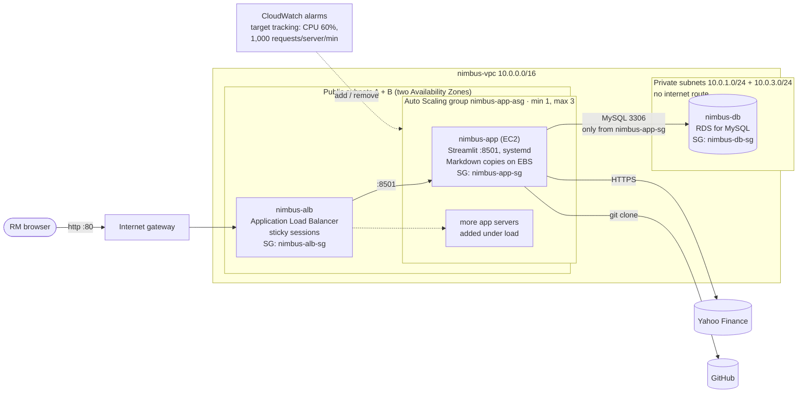

# Deploying Nimbus to the AWS Academy Sandbox

Template: [`scripts/nimbus-stack.yaml`](../scripts/nimbus-stack.yaml) (CloudFormation).
Region: **us-east-1** (the only region the Sandbox allows).

The deployment was built in stages. Each stage is the same template, extended:

| Stage | Adds | Status |
|---|---|---|
| 1 | VPC (2 public + 2 private subnets), security group, EC2 app server installed by user data, systemd service, health-checked `CREATE_COMPLETE` | ✅ Deployed in the Sandbox |
| 2 | Amazon RDS for MySQL in the private subnets; database security group that accepts MySQL only from the app servers; app connected to RDS | ✅ Deployed and verified (25, 27 and 29 Oct 2026), including the reboot test. Evidence: [`2026-10-27-stage2`](evidence/2026-10-27-stage2/README.md), [`2026-10-29-step12`](evidence/2026-10-29-step12/README.md) |
| 3 | **Automatic scaling (Feature 6, Lesson 9: AACF Module 10 and Lab 6):** Application Load Balancer, launch template, Auto Scaling group across two Availability Zones, target tracking on CPU and on requests per server, CloudWatch alarms | ✅ Verified on AWS on 31 Oct 2026 with v0.11.0 (`ff18611`): automatic scale-out 1 → 3 and scale-in 3 → 1 on the request alarms, any server reopens any discussion, a terminated server replaced automatically, data intact. [Evidence](evidence/2026-10-31-scaling/README.md). Not yet tested: a code update by rolling update |

## Architecture (Stage 3)


The same in text form (renders on GitHub):



## What the stack creates

Names are what the console's **Name** column shows (the resource's `Name` tag). Where
CloudFormation generates the resource's own name, it is `nimbus-<Resource>-<random>`, for
example the security group `nimbus-DbSecurityGroup-7SBoU3521ejt`, whose Name tag is
`nimbus-db-sg`. Renaming such resources in the template would make CloudFormation replace
them; for the DB subnet group that would replace the database, so the names are left as
generated.

| Resource | Name | Purpose |
|---|---|---|
| VPC 10.0.0.0/16 | `nimbus-vpc` | Private network for Nimbus |
| Internet gateway | `nimbus-igw` | Lets the public subnets reach the internet |
| Public subnets 10.0.0.0/24, 10.0.2.0/24 | `nimbus-public-a`, `nimbus-public-b` | Load balancer and app servers, one subnet in each of two Availability Zones |
| Private subnets 10.0.1.0/24, 10.0.3.0/24 | `nimbus-private-a`, `nimbus-private-b` | The database; **no route to the internet** |
| Route tables | `nimbus-rtb-public`, `nimbus-rtb-private` | Public: 0.0.0.0/0 → internet gateway. Private: local only (no NAT gateway, so no NAT cost) |
| Load balancer security group | `nimbus-alb-sg` | Port 80 from `AllowedWebCidr` (default anyone) |
| App security group | `nimbus-app-sg` | Port 8501 **only from `nimbus-alb-sg`**; SSH closed unless `AllowedSshCidr` is set |
| Database security group | `nimbus-db-sg` | Port 3306 **only from `nimbus-app-sg`**; nothing else can connect |
| Application Load Balancer | `nimbus-alb` | The address users open (`NimbusUrl`). Spreads new users across healthy servers; **sticky sessions** keep each user on one server |
| Target group | `nimbus-app-tg` | The app servers on port 8501, health-checked on `/_stcore/health` every 15 s |
| Launch template | `nimbus-app` | How every app server is built: Amazon Linux 2023, t2.micro, no IAM role, `nimbus-app-sg`, and the user data that installs Nimbus |
| Auto Scaling group | `nimbus-app-asg` | Keeps 1–3 app servers (`MinServers`, `MaxServers`) across both public subnets; replaces a server the load balancer reports unhealthy |
| Scaling policies (2) | `CpuScalingPolicy`, `RequestScalingPolicy` | Target tracking: average CPU 60% (as in Lab 6) and 1,000 load-balancer requests per server per minute. Each creates its own CloudWatch alarms |
| DB subnet group | `nimbus-dbsubnetgroup-…` (Name tag `nimbus-db-subnets`) | Places RDS in the two private subnets (RDS requires two AZs) |
| RDS for MySQL (db.t3.micro, 20 GB) | `nimbus-db` | Database `nimbus`: tables `clients`, `discussions`, `discussion_companies` (created by the app on first start). **Not publicly accessible** |

**How "complete" is decided:** CloudFormation creates RDS first, because the
user data needs its endpoint. The Auto Scaling group then launches the first
server. It installs Nimbus at the requested commit, runs
`scripts/check_database.py` (connects to RDS and creates the tables), starts the
service, and signals CloudFormation (`cfn-signal`) only after Nimbus answers its
health check. Any failure signals the reason and the stack shows
`CREATE_FAILED`. So `CREATE_COMPLETE` means the app is running **and** has
reached the database. It is still not the whole proof; the evidence below is.

**How automatic scaling works:** target tracking keeps a metric near a target,
like a thermostat. Each policy creates two CloudWatch alarms:
- **Scale out:** if average CPU stays above 60%, or the load balancer sends a
  server more than 1,000 requests a minute, for 3 minutes in a row, the Auto
  Scaling group adds servers. Target tracking adds **as many as the load needs,
  up to `MaxServers`**: on 31 Oct, about 6,200 requests a minute against a target
  of 1,000 took it straight from 1 to 3 servers. Each new server installs itself
  from the launch template and joins the load balancer once its health check
  passes: within 6 minutes on 31 Oct.
- **Scale in:** when **both** metrics have stayed well below target for about
  15 minutes, a server is removed. The group never goes below `MinServers` or
  above `MaxServers`.

The CPU policy follows Lab 6. Streamlit uses little CPU, so the request
policy is the one a classroom load test can trigger.

**Where the password goes:** you type `DBPassword` when creating the stack.
It is a `NoEcho` parameter, so CloudFormation shows `****`. User data writes it
into `/etc/nimbus.env` (readable by root only, read by systemd) with logging
switched off, so it does not appear in the setup log or the system log. Nimbus
only ever displays the database host, never the URL with the password.

## Verified on AWS (Stage 2, single server)

**31 Oct 2026, Stage 3** (commit `ff18611`, v0.11.0; independent check, sections
A–D below): deployment and security, the app through the load balancer (9 of 9),
automatic scale-out and scale-in, and self-healing all passed. The findings
(the stack had been created with `GitCommit` empty; four documentation or
cosmetic points) are fixed in v0.11.1. [Evidence](evidence/2026-10-31-scaling/README.md).

The earlier checks below used the Stage 2 template (one EC2 instance, no load
balancer). They remain valid for the network, RDS and app set-up, which Stage 3
keeps.

- **25 Oct 2026:** an independent audit (no changes made) confirmed:
  - `CREATE_COMPLETE` with the SUCCESS signal;
  - RDS *Available* with internet access disabled;
  - the database security group accepts only the app's security group;
  - generate, compare, note, save, search by ticker, reopen and the invalid-ticker case all passed.
- **27 Oct 2026** (commit `c6b9b46`): the same checks, plus the reboot test.
  [Evidence](evidence/2026-10-27-stage2/README.md).
- **29 Oct 2026** (commit `02c72aa`, v0.10.0): the instructor's acceptance
  test, step 12 (steps 1–11 on RDS), plus a reboot: 29 of 30 checks passed.
  [Evidence](evidence/2026-10-29-step12/README.md).

The Sandbox also shows a *Bastion Host* and a *Lab Instance*; they belong to
the AWS Academy lab environment, not to this stack.

## Deploy

1. **Push first.** Each new server clones from GitHub, not from your laptop.
   Note the commit to deploy: `git log --oneline -1`.
2. Start the Sandbox, wait for the green dot, and open the AWS console. Check
   the region is **N. Virginia**.
3. If an older `nimbus` stack exists (for example the single-server Stage 2
   stack), delete it first and wait for `DELETE_COMPLETE`. This deletes its
   saved discussions (test data).
4. Go to **CloudFormation → Create stack → With new resources (standard) →
   Upload a template file**, and choose `scripts/nimbus-stack.yaml`.
5. Stack name: `nimbus`. Parameters:
   - `DBPassword`: type a **new** password, 8–41 letters and digits only. Do
     not reuse any real password. Nobody needs to see it again: the app reads
     it from the server.
   - `GitBranch`: `main`.
   - `GitCommit` (**required**): the exact commit to deploy, from
     `git log --oneline -1`, e.g. `ff18611`. Every server, including those the
     Auto Scaling group adds later, runs this commit. (Before v0.11.1 it could be
     left empty; servers added later would then have cloned whatever was newest
     on GitHub, so two servers could run different code.)
   - `InstanceProfileName`: leave **empty** (no IAM role; confirmed to work
     with the Auto Scaling group on 31 Oct).
   - `MinServers` 1, `MaxServers` 3, `CpuTargetPercent` 60,
     `RequestsPerServerTarget` 1000: keep the defaults.
   - Leave the others at their defaults (`DBUsername` = `nimbusadmin`).
6. Click **Next** twice, then **Submit**. It takes about 20–25 minutes: RDS
   takes about 6–10 minutes, then the first server about 2–5 minutes (8 minutes
   in total on 31 Oct).
7. Open the `NimbusUrl` output: `http://nimbus-alb-….elb.amazonaws.com`
   (http, not https, and no port number).

## Evidence to capture

Crop out the account ID in every screenshot. Never screenshot the Parameters
tab with a visible password (it shows `****`, which is fine).

### A. Deployment and security

1. **Stack → Events:** `NimbusDatabase` `CREATE_COMPLETE`, then
   `AppAutoScalingGroup` *"Received SUCCESS signal with UniqueId i-…"*, then the
   stack at `CREATE_COMPLETE`.
2. **Which code is deployed:**
   - the app's sidebar shows *Nimbus … · commit … · server ip-10-0-… · server started …*;
   - the same commit is in the server's system log (**EC2 → Instances →
     nimbus-app → Actions → Monitor and troubleshoot → Get system log**):
     `nimbus-setup: deployed commit 1a14188 from branch main (requested commit: 1a14188)`;
   - the deployed and requested commits must be the same.
3. **Stack → Outputs:** `NimbusUrl`, `AutoScalingGroup`, `TargetGroup`,
   `DatabaseEndpoint`, `InstanceProfile` = `none`.
4. **RDS → Databases → nimbus-db → Connectivity & security:**
   - *Publicly accessible: No*;
   - VPC `nimbus-vpc`; subnet group `nimbus-dbsubnetgroup-…` (generated name; its
     Name tag is `nimbus-db-subnets`);
   - security group `nimbus-db-sg`.
5. **Security groups, inbound rules:**
   - `nimbus-alb-sg`: 80 from 0.0.0.0/0;
   - `nimbus-app-sg`: 8501 from the `sg-…` of `nimbus-alb-sg` (not an IP range), and 22 from 127.0.0.1/32;
   - `nimbus-db-sg`: 3306 from the `sg-…` of `nimbus-app-sg`.
6. **The servers are not directly reachable:** a server's own address
   (`http://<its public IP>:8501`) does not load. Only the load balancer
   address works.
7. **VPC → Route tables → nimbus-rtb-private → Routes:** only the `local` route.
8. **IAM:** EC2 → the `nimbus-app` instance: *IAM role: –* (no role, by design).

### B. The app through the load balancer (instructor's acceptance test)

At `NimbusUrl`:
- **New client** `C-1001`; add `AAPL, MSFT`; **Generate comparison**.
- Show the price chart, the comparison table (revenue growth, net margin,
  debt-to-equity) and the trends.
- **News** tab: sources and summaries.
- **Discussion** tab: client's interests, then **Save discussion**.
- **History:** the caption reads *Database: mysql+pymysql at
  nimbus-db.….rds.amazonaws.com:3306 · 1 client, 1 discussion, 2 company
  records*.
- Search by client `C-1001` and by company `msft`, and reopen: the values at
  the time of the discussion match.
- **Download** the saved discussion (Markdown).

### C. Automatic scaling (Feature 6)

Plan about 40–50 minutes inside one Sandbox session.

1. **Before:**
   - **EC2 → Auto Scaling groups → nimbus-app-asg:** *Desired 1, Min 1, Max 3*;
   - **Target groups → nimbus-app-tg → Targets:** 1 *healthy*;
   - **CloudWatch → Alarms:** four `TargetTracking-nimbus-app-asg-…` alarms. At rest
     the two *AlarmHigh* alarms are *OK* and the two *AlarmLow* (scale-in) alarms
     are **In alarm**. That is normal: load is low, but the group is already at its
     minimum, so there is nothing to remove.
2. **Create load** for about 10 minutes, so requests per server go above 1,000 a
   minute. 20 loops gave about 6,200 requests a minute on 31 Oct (scales 1 → 3).
   For a gentler 1 → 2, use about 4 loops (about 1,200–1,500 a minute). Use either:
   - **CloudShell** (console toolbar, if the Sandbox allows it):
     ```bash
     URL=http://nimbus-alb-….elb.amazonaws.com   # the NimbusUrl output
     for i in $(seq 20); do (end=$((SECONDS+600)); while [ $SECONDS -lt $end ]; do curl -s -o /dev/null "$URL/"; done) & done; wait
     ```
   - or **Windows PowerShell** on a laptop:
     ```powershell
     $url = "http://nimbus-alb-....elb.amazonaws.com/"   # the NimbusUrl output
     $jobs = 1..10 | ForEach-Object { Start-Job -ArgumentList $url { param($u)
       $end = (Get-Date).AddMinutes(10)
       while ((Get-Date) -lt $end) { try { Invoke-WebRequest $u -UseBasicParsing | Out-Null } catch {} } } }
     $jobs | Wait-Job | Remove-Job
     ```
3. **Scale-out evidence** (about 4–6 minutes after the load starts, then up to 6
   minutes for the new servers):
   - **CloudWatch → Alarms:** the request policy's *AlarmHigh* alarm in **In alarm**;
   - **Auto Scaling group → Activity:** *"Launching a new EC2 instance"*, with the
     cause *"… a monitor alarm TargetTracking-nimbus-app-asg-AlarmHigh-… in state
     ALARM triggered policy nimbus-RequestScalingPolicy-… changing the desired
     capacity from 1 to 3"* (or 1 to 2 with the lighter load);
   - **Target group → Targets:** all servers *healthy*, spread across the two
     Availability Zones;
   - **CloudWatch → Metrics → ApplicationELB → RequestCountPerTarget:** the graph
     above 1,000.
4. **Any server, same data:**
   - open `NimbusUrl` in a few private or incognito windows until the sidebar
     shows the other server's name (each new window may get a different server);
   - on that server, search and reopen the discussion saved in B: the same values
     and note.
5. **Scale in:** stop the load (Ctrl+C, or wait for the 10 minutes to end).
   About 15–20 minutes later:
   - **Activity:** *"Terminating EC2 instance"*, cause *"… AlarmLow-… in state
     ALARM triggered policy … changing the desired capacity from 3 to 2"*, then 2 to 1;
   - *Desired 1*;
   - the saved discussions are all still there.
6. **Label manual actions as manual.** Any change you make yourself, for
   example editing *Desired capacity*, is not automatic scaling.

### D. Self-healing and persistence (replaces the reboot test)

**EC2 → Instances →** select the one `nimbus-app` server **→ Instance state →
Terminate** (this deletes only that server; RDS and the saved discussions
stay).
- The load balancer reports it unhealthy.
- **Activity** shows the group launching a replacement.
- The load balancer removes the server at once and shows *503 Service Temporarily
  Unavailable* until the replacement is healthy.
- About 4 minutes later (31 Oct), `NimbusUrl` works again: the sidebar shows a new
  server name and a new *server started* time, and the saved discussion reopens
  unchanged.

Only do this with the team's agreement: the app is unavailable for those minutes.

### Optional: SQL directly against RDS

For a viva question on SQL:
1. Set `AllowedSshCidr` to your own IP followed by `/32` when creating the stack,
   then SSH to a server.
2. Run `sudo dnf install -y mariadb105`, then
   `mysql -h <DatabaseEndpoint> -u nimbusadmin -p nimbus`, and type the password
   at the prompt.
3. Run, for example:

```sql
-- every saved discussion, newest first, with its client
SELECT d.discussion_date, d.client_id, c.client_name, d.tickers, d.client_interests
FROM discussions d JOIN clients c ON c.client_id = d.client_id
ORDER BY d.discussion_date DESC, d.created_at DESC;

-- the values recorded for each company at the time of each discussion
SELECT discussion_id, ticker, stock_price, price_date, revenue_growth, net_margin, debt_to_equity
FROM discussion_companies ORDER BY discussion_id, ticker;
```

Close SSH again afterwards. This step is not needed for the demo.

## Troubleshooting

| Symptom | Check |
|---|---|
| `CREATE_FAILED` on `NimbusDatabase` | Read the status reason. If it names the engine version or instance class, choose another allowed value (e.g. `DBEngineVersion` `8.0`) and create the stack again. |
| `CREATE_FAILED` on `LoadBalancer`, `AppAutoScalingGroup` or a scaling policy: *not authorized* | The Sandbox does not allow that service for this account. Note the exact message and ask the instructor. |
| `AppAutoScalingGroup` fails: *cannot reach RDS* (reason) | Check `nimbus-db-sg` inbound (3306 from `nimbus-app-sg`) and that `nimbus-db` is *Available*. The server's system log shows each attempt from `check_database.py`. |
| `AppAutoScalingGroup` fails: other reason | **EC2 → Instances → nimbus-app → Actions → Monitor and troubleshoot → Get system log**; look for lines after `nimbus-setup`, `fatal` or `ERROR`. |
| `AppAutoScalingGroup` times out (*did not receive the required number of signals*), but the system log ends with Nimbus running and the target is *healthy* | The success signal did not reach CloudFormation. Look for a `cfn-signal` error in the system log. If it reports missing credentials or *not authorized*, delete the stack and create it again with `InstanceProfileName` = `LabInstanceProfile` (the Sandbox's role, used only for this signal). Record this in the README, because the no-role design would then change. |
| `Commit … not found in the repository` | The `GitCommit` value is wrong or not pushed yet. Check `git log --oneline -1` and that it is on GitHub, then create the stack again. |
| `… iamInstanceProfile … invalid`, or *not authorized to perform: iam:PassRole* | Only if `InstanceProfileName` was set: the profile does not exist or may not be used. Create the stack again with it empty (the default). |
| `DBInstanceIdentifier … already exists`, or the load balancer, target group or launch template name already exists | Resources from an earlier stack are still there: wait until it is deleted, or use another stack name. |
| `NimbusUrl` gives *502* or *503* | No server is healthy yet: a new server needs a few minutes (2–6 on 31 Oct). Check **Target groups → nimbus-app-tg → Targets**. |
| Target stays *unhealthy* | The app did not start: read the server's system log. |
| The page loads, then shows *connection lost* again and again | The live connection is not staying on one server: check that stickiness is on (**Target group → Attributes**). |
| No scale-out during the load test | Check the request count is really above 1,000 per server per minute (**CloudWatch → Metrics → ApplicationELB → RequestCountPerTarget**); add more parallel loops. Alarms need about 3 minutes above target. |
| History says *Cannot reach the briefing database* | RDS stopped or still starting (e.g. after the Sandbox was resumed). Wait until *Available*, then reload. |
| Page does not load at all | Use `http://`, not `https://`, and no `:8501`; check the `nimbus-alb-sg` inbound rule for 80. |

## Sandbox sessions

When the Sandbox session ends, the stack stays, but its servers and database
may be stopped. After starting a new session:
1. Start **RDS → nimbus-db** if it is stopped, and wait for *Available*.
2. The Auto Scaling group sees stopped servers as unhealthy and replaces
   them. Each replacement installs the same commit from GitHub, so allow a few
   minutes (about 4 on 31 Oct).
3. `NimbusUrl` stays the same: the load balancer's address does not change when
   servers are replaced.

Saved discussions are in RDS and survive.

## Keeping saved discussions

Saved discussions live in RDS. Each server also keeps Markdown copies on its
own disk; these go when the server goes, and the download is rebuilt from RDS.

- **Deleting the stack deletes them.** The database is set to
  `DeletionPolicy: Delete` with no final snapshot (a Sandbox choice: no
  leftover snapshots and their storage).
- **Deploying new code no longer needs a new stack** (Stage 3; **not yet tested
  on AWS**). Choose **Update stack → Use current template** and change only
  `GitCommit`:
  - CloudFormation creates a new launch-template version;
  - the Auto Scaling group then replaces the servers one at a time (a rolling
    update), waiting for each new server's success signal;
  - RDS is not changed, so the saved discussions stay.
  - Do not change `DBPassword`, `DBUsername` or the database settings in an
    update.
- **How we work with this:** create the final stack once, on the submission
  commit, record the final evidence and give the demo on that stack. Resume it
  between Sandbox sessions; do not recreate it.

## Clean up after testing

**CloudFormation → nimbus → Delete.** This removes every resource listed above,
including the load balancer, the servers, the database (no final snapshot is
kept) and every saved discussion. If **Delete** is greyed out, select the
stack first, or wait for any operation in progress to finish.

## Design choices to be able to explain

- **Scaling with a load balancer and an Auto Scaling group (Lesson 9, AACF
  Module 10 and Lab 6):**
  - the load balancer gives users one address;
  - the Auto Scaling group adds and removes servers automatically, and replaces
    failed ones;
  - target tracking chooses when: CPU, as in Lab 6, plus requests per server,
    which reflects RM traffic directly and can be shown in a classroom test;
  - max 3 servers keeps the Sandbox cost and limits low.
- **Sticky sessions:**
  - a Streamlit session (the comparison on screen, a half-written note) lives in
    one server's memory, so each user must stay on one server;
  - saved discussions are in RDS, so any server can reopen any of them;
  - if a server is removed (scale-in or failure), its users lose unsaved work and
    reconnect to another server. Saved work is safe.
- **Servers accept traffic only from the load balancer:** `nimbus-app-sg`
  allows 8501 only from `nimbus-alb-sg`, so the servers are not directly on the
  internet. The database accepts only the app servers.
- **RDS in private subnets, no public access (Lesson 8):**
  - the database has no internet route and no public address;
  - the only way in is from the app servers, enforced by a
    security-group-to-security-group rule rather than an IP range;
  - so it works for any number of servers, whatever their addresses.
- **Discussions in RDS, a Markdown copy on EBS (instructor feedback; Lessons 7
  and 8):**
  - RDS holds the client, the discussion and its note, one row per company with
    the values observed at the time, and the complete snapshot used to reopen it;
  - each server's EBS disk keeps a readable Markdown copy;
  - because reopening reads RDS, any server can reopen any discussion.
- **Several servers, one database (v0.10.3, `src/storage/database.py`):**
  - each server keeps at most 10 MySQL connections, so 3 servers stay well under
    a `db.t3.micro`'s limit (about 60–80);
  - two servers saving the same new client at once both succeed.
- **Every server built the same way:**
  - the launch template's user data installs the pinned commit with the exact
    package versions in `requirements-lock.txt`;
  - nothing is configured by hand, so a server added at 3 a.m. is identical to
    the first.
- **No NAT gateway:** the private subnets only hold the database, which needs
  no internet access. This also avoids the NAT gateway's hourly cost. The app
  servers are in public subnets, behind the load balancer, so they can reach
  GitHub and Yahoo.
- **Secrets via a NoEcho parameter:** the password is never stored in the
  repository or template, and is not logged. See *Known limitations* in the
  README for what Secrets Manager would add.
- **Sandbox-sized database:** `db.t3.micro`, 20 GB gp2, single-AZ, no automated
  backups, deleted with the stack: low cost and faster to create. Production
  would use Multi-AZ, backups and deletion protection. The app servers already
  span two Availability Zones; the database does not.
- **IAM: no role on the app servers (least privilege):**
  - Nimbus calls no AWS APIs: it reaches RDS with a database username and
    password, and Yahoo over HTTPS;
  - `cfn-signal` worked without a role on the single-server stack, so a role
    would only add unused permissions;
  - confirmed with the Auto Scaling group on 31 Oct: every server reported
    success and shows *IAM role: –*. `InstanceProfileName` can still attach one
    if a later change needs AWS access.
  - The access model for people is in the README, *Security and access*.
- **SSH closed by default:** troubleshooting uses the EC2 system log (as in
  Lesson 7). SSH can be opened to a single IP with `AllowedSshCidr`.
- **systemd instead of `nohup`:** the app restarts if it crashes and starts
  again after a reboot.
- **Health-checked creation and updates:** a green stack means a working app
  connected to its database, not just a running server. During a code update,
  each new server must pass the same check before the next old one is replaced.
